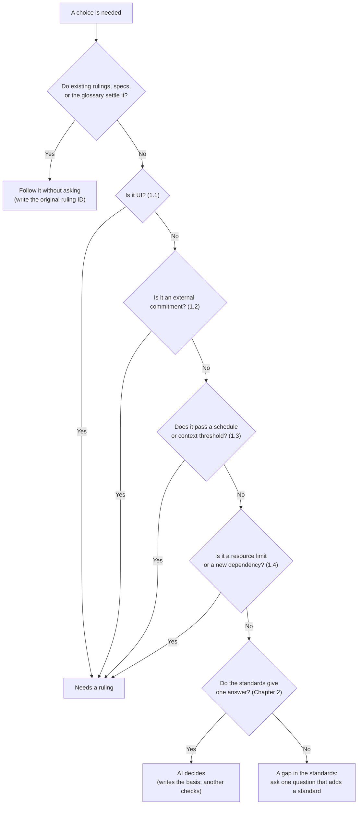

# Rules for Reducing Owner Rulings

**Version:** `2026-11-08T10:05:07+09:00`

> **Related documents:** [Software NDD Development Review Standards](review-standards-en.md)

---

## Introduction

### Purpose

This document sets the rules that sort the choices AI meets in its work into two groups: choices that wait for the owner's ruling, and choices that AI makes itself.

- One reason work stops is waiting for the owner's ruling. This document reduces the number of those waits.
- Only rulings the owner does not need to judge are reduced. Rulings on purpose and names (the work NDD leaves to people) are not reduced.

### Scope

- This document applies to every project where a team of AI builds software under the owner.
- Each team's rules hold one line that refers to this document. They do not copy it (SSOT).

### Terms

| Term | Meaning |
|:---|:---|
| Owner | The person who owns the project. The owner gives rulings |
| Ruling | The owner's decision that settles a choice. Each ruling is recorded with an ID |
| BOSS | The AI session that leads one team |
| PMO | The AI session that keeps the BOSS's plan |
| GQA | A Markdown file of questions that the owner answers in answer fields |

### Version

- The version of this document is the date and time, to the second, when an update was finished. The format is ISO 8601 with the time offset.
- Whoever updates this document (a person or AI) changes the version at the top to that date and time on every update.
- The Japanese and English versions are updated together and carry the same value.

---

## 1. Choices That Need a Ruling (MUST)

AI MUST NOT settle a choice that falls under any of the kinds below without the owner's ruling. One choice can fall under several kinds. If it falls under even one kind that needs a ruling, it needs a ruling.

### 1.1 UI

Everything the user sees or touches is UI.

| What falls here | Examples |
|:---|:---|
| Layout, size, color, line width, and spacing of what appears on screen | Panel width, line thickness, button position |
| Words on screen | Button names, messages, tooltips, help text |
| Operations | Keys, clicks, drags, shortcuts, wait times |
| Initial values shown on screen | Default settings of a new document |
| Appearance of output | Printing, image export, how Mermaid is drawn |

### 1.2 External Commitments

What a party outside this software (a person, other software, or AI) relies on. **Glossary terms fall here.**

| What falls here | Examples |
|:---|:---|
| Formats of files that are saved or exchanged | Schemas and key names, round trips with other formats, extensions, file naming rules |
| Public APIs | API members, seams, MCP tool names and arguments |
| Names visible outside | Product names, command names, skill names, plugin names, glossary terms |
| Behavior visible to outside parties | The boundary between accepted and rejected input |

### 1.3 Schedule and Context

| Condition | Threshold | How to measure |
|:---|:---|:---|
| The schedule slips badly | The forecast for the next milestone slips by 1 day or more, or the remaining critical path grows by 20% or more | The PMO reports it from the plan and the delay diagnostics |
| A task uses much context | One task is expected not to finish in one session | The BOSS estimates it before the task starts |
| The weekly limit is near | Less than 20% of the weekly usage remains | The BOSS reads the usage display |

- The ruling does not ask about single choices. It asks what to do first, what to put off, and which model to use.
- Do not turn the right choice of Chapter 2 into a shortcut because of delays or usage. A shortcut becomes debt (Chapter 5). If a shortcut is needed, ask for a ruling on that too.

### 1.4 Resource Limits and New Dependencies

| What falls here | Examples |
|:---|:---|
| Resource limits | The size limit of a distributed artifact (such as its size after gzip) |
| New dependencies | Adding a new library or package |

---

## 2. Choices That Need No Ruling

A choice that falls under none of Chapter 1 and has one answer under the [Software NDD Development Review Standards](review-standards-en.md) (the standards below) is made by AI.

- **"Has one answer" means:** exactly one option passes every MUST in the Overall Review Checklist. Or several pass, and exactly one of them also meets the SHOULDs and the design principles (SRP, SSOT, and so on).
- **Examples:** how to split functions, how to cut internal layers, internal variable and function names (following NEIM), how to write tests (Gherkin), how to remove duplication (SSOT), how to name magic numbers.
- **What AI does:**
    1. In the row it decided, it writes the perspective of the standards it relied on (the name, and MUST or SHOULD) and the version of the standards.
    2. It has a subagent other than the decider check that the row really falls under none of Chapter 1 (T2 in Chapter 5).
- **When the standards give no single answer:** do not ask about the single choice. Ask one question that adds a standard: "choices of this kind are decided this way". Once decided, the same kind of question does not come up again.
- **Names:** internal names are decided by the standards (NEIM and the glossary). Names visible outside and glossary terms fall under 1.2 and need a ruling.

---

## 3. Order of Judgment

Judge in the order of the figure below.

---

## 4. How to Proceed with UI

Build UI with the recommended values and add a provisional mark (`@provisional`, or a team's mark that does the same job). Show the owner a sample they can touch, and settle it by a ruling. Work does not stop.

---

## 5. Safeguards for Delegation

The more AI decides, the more is decided where the owner does not look. So debt is turned into numbers, and those numbers do not grow without the owner's consent. Each team puts in all five measures below.

| Measure | What each team does |
|:---|:---|
| T1. Weekly debt report | Every week, the PMO puts the baselines, the number of provisional marks, the known reds, the function-size overruns, and the magic numbers into one table, and sends the change from last week to the owner through the BOSS |
| T2. Another checks the classification | A subagent other than the decider reads the rows AI decided under Chapter 2 and checks that they fall under none of Chapter 1. If in doubt, the row goes back to a ruling |
| T3. Shrink delegation by the overturn rate | Count, by kind, the decisions AI made under Chapter 2 that the owner later overturned. For a kind whose overturn rate passes 10%, ask the owner whether to move it to Chapter 1 |
| T4. Debt definition table | Make a table of what counts as debt, and get the owner's ruling once. On finding a kind not in the table, propose turning it into a check as one question in a GQA |
| T5. Regular independent reviews | Run an independent review from all perspectives of the standards once a week |

The owner has not yet ruled on the "10%" of T3. When the first T3 count is reported, ask for the value as well.

---

## References

- Chapter 9 of GoodRelax/Sandbox `Analisys/reduce-owner-rulings-study.md` (commit `b0806d7`). This document moves that text here as the master copy.
- The owner's rulings: Questions 1 to 5 in Chapter 8 of the study above (2026-11-07), and Questions R1 and R2 of JGQA (2026-11-08; R2 added 1.4).
