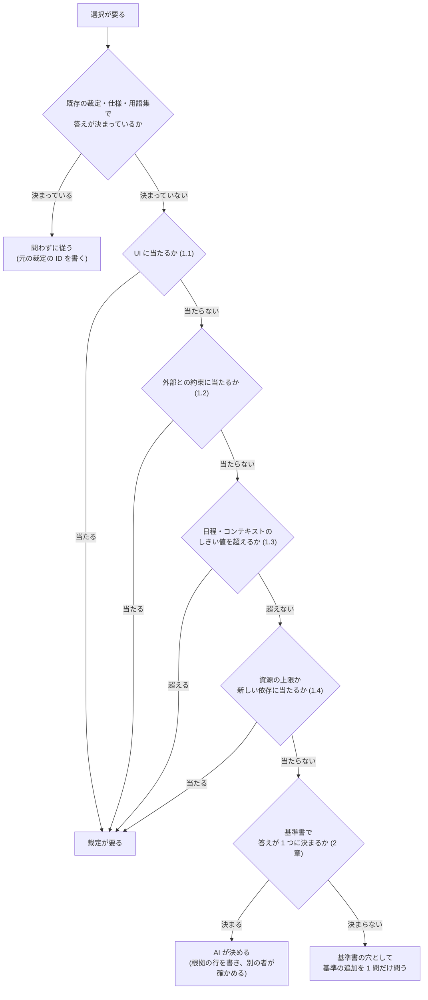

# オーナーの裁定を減らす規則

**バージョン:** `2026-11-08T10:05:07+09:00`

> **関連文書:** [ソフトウェアNDD開発レビュー基準書](review-standards-ja.md)

---

## はじめに

### 目的

本書は、AI が仕事の中で出会う選択を、2 つに分ける規則を定める。オーナーの裁定を待つ選択と、AI が自分で決める選択である。

- 作業が止まる理由の 1 つは、オーナーの裁定待ちである。本書は、その数を減らす。
- 減らすのは、オーナーが判断しなくてよい裁定だけである。目的と名前の裁定（NDD で人に残す仕事）は減らさない。

### 適用範囲

- 本書は、オーナーの下で AI のチームが SW を作るすべてのプロジェクトに当てる。
- 各チームの規則は、本書への参照を 1 行持つ。本書を写さない（SSOT）。

### 用語

| 用語 | 意味 |
|:---|:---|
| オーナー | プロジェクトの持ち主である人。裁定を下す |
| 裁定 | オーナーが選択を確定すること。裁定には ID を付けて記録する |
| BOSS | 1 つのチームを率いる AI のセッション |
| PMO | BOSS の計画を管理する AI のセッション |
| GQA | オーナーが回答欄に答える、問いの Markdown のファイル |

### バージョン

- 本書のバージョンは、更新を終えた日時を秒まで書いた値である。形式は ISO 8601 で、時差も書く。
- 本書を更新する者（人または AI）は、更新のたびに、冒頭のバージョンをその日時に変える。
- 日本語版と英語版は一緒に更新し、同じ値にする。

---

## 1. 裁定が要るもの（MUST）

AI は、次のどれかに当たる選択を、オーナーの裁定なしに確定してはならない。1 つの選択が複数の種類に当たることがある。裁定が要る種類に 1 つでも当たれば、裁定が要る。

### 1.1 UI

利用者の目に見えるもの、または手で触れるものは、すべて UI とする。

| 当たるもの | 例 |
|:---|:---|
| 画面に出るものの配置・大きさ・色・線幅・余白 | パネルの幅、線の太さ、ボタンの位置 |
| 画面に出る言葉 | ボタンの名前、メッセージ、ツールチップ、ヘルプの文 |
| 操作 | キー、クリック、ドラッグ、ショートカット、待ち時間 |
| 画面に出る初期値 | 新しい文書の既定の設定 |
| 出力の見た目 | 印刷、画像の書き出し、Mermaid の描き方 |

### 1.2 外部との約束

このソフトの外にいる相手（人・他のソフト・AI）が当てにするものとする。**用語集の語はここに入る。**

| 当たるもの | 例 |
|:---|:---|
| 保存・交換するファイルの形式 | スキーマとキー名、他の形式との往復、拡張子、ファイル名の決まり |
| 公開する API | API のメンバ、継ぎ目、MCP のツール名と引数 |
| 外に見える名前 | 製品名、コマンド名、スキルの名前、プラグインの名前、用語集の語 |
| 外の相手に見える振る舞い | 受け入れる入力と拒む入力の境目 |

### 1.3 日程とコンテキスト

| 条件 | しきい値 | 測り方 |
|:---|:---|:---|
| 日程が大幅に遅れる | 次のマイルストーンの見込みが 1 日以上遅れる、またはクリティカルパスの残りが 20% 以上延びる | PMO が計画と遅延の診断で出す |
| コンテキストの使用量が多い | 1 つの仕事が、1 本のセッションで終わらないと見込まれる | 仕事を始める前に、BOSS が見積もる |
| 週間の上限が近い | 週間の使用量の残りが 20% を切る | BOSS が使用量の表示を見る |

- 裁定で問うのは、個々の選択ではない。何を先にし、何を後に回すか、どのモデルで回すかを問う。
- 遅れや使用量を理由に、2 章の正しい選択を手抜きに変えない。手抜きは負債になる（5 章）。手抜きが要るなら、それも裁定で問う。

### 1.4 資源の上限と新しい依存

| 当たるもの | 例 |
|:---|:---|
| 資源の上限 | 配布物の大きさの上限（gzip 後の大きさなど） |
| 新しい依存 | ライブラリやパッケージを新しく足す |

---

## 2. 裁定が要らないもの

1 章のどれにも当たらず、[ソフトウェアNDD開発レビュー基準書](review-standards-ja.md)（以下、基準書）で答えが 1 つに決まる選択は、AI が決める。

- **「答えが 1 つに決まる」とは:** 選択肢のうち、総合レビューチェックリストの MUST をすべて PASS するものが 1 つだけある場合。または、複数が PASS し、そのうち 1 つだけが SHOULD や設計原則（SRP、SSOT など）にも合う場合。
- **例:** 関数の分け方、内部の層の切り方、内部の変数名と関数名（NEIM に従う）、試験の書き方（Gherkin）、重複の消し方（SSOT）、マジックナンバーの名前付け。
- **AI がすること:**
    1. 決めた行に、根拠にした基準書の観点（名前と、MUST か SHOULD か）と、基準書のバージョンを書く。
    2. 決めた者とは別のサブエージェントに、その行が本当に 1 章に当たらないかを確かめさせる（5 章の T2）。
- **基準書で答えが決まらないとき:** 個々の選択ではなく、「この種類の選択はこう決める」という基準の追加を 1 問だけ問う。一度決めれば、同じ種類の問いは以後出ない。
- **名前:** 内部の名前は、基準書（NEIM と用語集）で決める。外に見える名前と用語集の語は、1.2 に当たるので裁定が要る。

---

## 3. 判定の順番

次の図の順に判定する。

---

## 4. UI の進め方

UI は、推奨値で作り、暫定の印（`@provisional` か、各チームの同じ働きの印）を付ける。触れる見本をオーナーに見せて、裁定で確定する。作業は止めない。

---

## 5. 委任の安全策

AI が決める範囲を広げるほど、オーナーが見ない所で決まることが増える。そのため、負債を数にし、その数がオーナーの了承なしには増えないようにする。各チームは、次の 5 つをすべて入れる。

| 策 | 各チームですること |
|:---|:---|
| T1. 負債の週報 | PMO が毎週、基準線・暫定の印の数・既知の赤・関数の大きさの超過・マジックナンバーを 1 表にし、先週との差を BOSS 経由でオーナーに出す |
| T2. 分類を別の者が確かめる | 2 章で AI が決めた行を、決めた者とは別のサブエージェントが読み、1 章に当たらないかを見る。疑いがあれば裁定へ戻す |
| T3. 覆った率で委任を縮める | 2 章で AI が決め、後でオーナーが覆した数を種類ごとに数える。覆った率が 10% を超えた種類は、1 章へ移す案をオーナーに問う |
| T4. 負債の定義表 | 何を負債とみなすかの表を作り、オーナーの裁定を 1 回取る。表に無い種類に気づいたら、検査に下ろす案を GQA の 1 問として出す |
| T5. 独立レビューを定期に回す | 基準書の全観点で、週 1 回、独立レビューを回す |

T3 の「10%」は、オーナーがまだ裁定していない値である。最初の T3 の集計を出すときに、値も一緒に問う。

---

## 出典

- GoodRelax/Sandbox `Analisys/reduce-owner-rulings-study.md` の 9 章（コミット `b0806d7`）。本書はその本文を正本として移したものである。
- オーナーの裁定: 上の検討書の 8 章の問 1〜5（2026-11-07）、JGQA の問 R1・R2（2026-11-08。R2 で 1.4 を足した）。
